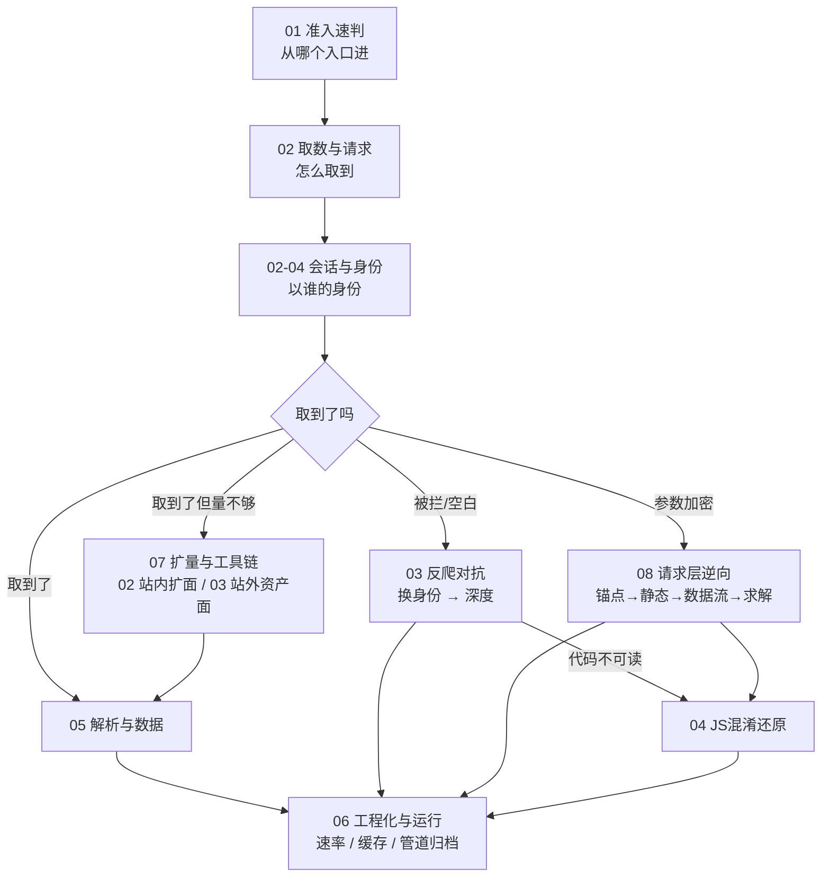

# 爬虫技能分类导航（总览）

> 这是**地图**，不是安装目录。46 个书源 skill + 14 个整合进来的实战 skill，真实源码在各叶子目录下的 `<slug>/SKILL.md`；已安装副本在 `~/.trae-cn/skills/<slug>/`。
> 本导航用中文层级目录把同一功能的 skill 归到一起，**只读导航、不参与运行**。
> 不要改 skill 的目录名：`~/.trae-cn/skills/` 下目录名必须等于 SKILL.md 的 `name` 字段，改名会让 skill 失效。

## 两个来源

| 来源 | 内容 | skill 数 |
|---|---|---|
| 6 本书 + 1 份官方文档 | 权威指南 2e(9) / 逆向进阶实战(10) / 反爬虫AST(9) / Scrapy实战(7) / Python项目案例(5) / 用Python写网络爬虫(4) / Scrapling文档(2) | 46 |
| 实战沉淀 + 漏洞筛查技能库整合 | 17-内容采集与范围扩张(4)、02-逆向工程(7)、08-认证会话(2)、10-客户端前端(1) | 14 |
| 自建 | 07 / 08 两类的方法论文档（不含书源） | — |

合计 **60 个 skill**，覆盖 8 个大类。

## 八个大类

| 目录 | 一句话 | skill 数 |
|---|---|---|
| `01-决策与准入` | 动手前 5 分钟定**从哪个入口进最省事**（已取消否决权） | 5 |
| `02-取数与请求` | 把一次成功请求变成可重复的取数通道；含会话与身份 | 9 |
| `03-反爬对抗与逆向` | 被拦、抓不到、参数加密、App 加固时的分诊与定位；含深度与反爬 | 12 |
| `04-JS混淆还原` | 代码不可读时，先判层再逐层还原 | 8 |
| `05-解析与数据` | 拿到内容之后：选选择器、定表结构、验分页 | 5 |
| `06-工程化与运行` | 让它长期、稳定、可中断地跑起来；含管道与归档 | 12 |
| `07-扩量与工具链` | 客户端选型 + 站内扩面 + 站外资产面，把采集范围撑开 | 1 |
| `08-请求层逆向与签名` | 参数怎么算出来的：锚点 → 静态 → 数据流 → 求解 → 脱壳 → 前端面 | 7 |

## 全景分层

正常路径是 01 → 02 → 05 → 06；03/04/08 是**阻力分支**，07 是**放大器**。完整走法与判层决策树见 [流程总纲.md](流程总纲.md)。

## 按"你现在的处境"反查

| 你的原话 | 去这里 |
|---|---|
| "这个站能爬吗 / 从哪儿进最快" | `01-决策与准入/01-合规与尽调` |
| "该用 requests 还是上浏览器 / 有没有更便宜的入口" | `01-决策与准入/02-成本与路径` |
| "这个表单提交没反应 / 登录态丢了" | `02-取数与请求/01-单请求复现` |
| "页面数据是空的 / 接口返回 403 该不该删参数" | `02-取数与请求/02-接口与表格` |
| "扫码登录、轮询状态、等回调" | `02-取数与请求/03-异步会话` |
| "要登录才能看 / cookie 半天就失效 / 换账号数据不一样" | `02-取数与请求/04-会话与身份` |
| "抓不到包 / 403 白页 / 一开控制台就断点" | `03-反爬对抗与逆向/01-通道与封禁` |
| "有验证码，过还是绕还是降频" | `03-反爬对抗与逆向/02-人机验证` |
| "sign 在哪生成 / 搜不到 / 补环境 / 复现对不上" | `03-反爬对抗与逆向/03-Web参数定位` → `08` |
| "App 里找 sign / 有壳 / so 层加密" | `03-反爬对抗与逆向/04-移动端逆向` → `08-05` |
| "只抓到首页 / 翻到第 10 页就空 / 一直转圈" | `03-反爬对抗与逆向/05-深度与反爬` |
| "一坨乱码，先判几层" | `04-JS混淆还原/01-判层与总装` |
| "字符串解不开 / 顺序乱 / 套娃取值 / 改名改错" | `04-JS混淆还原/02-单点还原` |
| "自己写混淆器，一加载就崩" | `04-JS混淆还原/03-造侧约束` |
| "选择器改版后失效 / 抓空" | `05-解析与数据/01-选择器与抗改版` |
| "字段怎么定 / 表怎么建 / 翻页翻不动" | `05-解析与数据/02-建模与分页` |
| "只有几十条样本能不能报准确率" | `05-解析与数据/03-样本评估` |
| "Scrapy 规则不跟进 / 配置不生效 / 缺字段" | `06-工程化与运行/01-Scrapy框架` |
| "开几个线程 / 限速 / 全站遍历怎么停" | `06-工程化与运行/02-速率与范围` |
| "跑很久 / 会中断 / 反复重跑" | `06-工程化与运行/03-缓存与复用` |
| "断了要重头跑 / 怎么只抓新增 / 怎么核对漏没漏" | `06-工程化与运行/04-管道与归档` |
| "requests 403、浏览器 200 / 用哪个客户端" | `07-扩量与工具链/01-客户端与指纹工具` |
| "只翻到第 10 页 / 搜索只给 1000 条" | `07-扩量与工具链/02-采集面扩展` |
| "只有官网，还有别的入口吗 / 老数据还能弄到吗" | `07-扩量与工具链/03-资产面扩张` |
| "不知道某个函数在哪 / 没有符号表怎么找" | `08-请求层逆向与签名/01-锚点定位` |
| "400 KB 压缩 JS 从哪看起 / 剥离 so 怎么分析" | `08-请求层逆向与签名/02-静态审计` |
| "这个值从哪来 / token 传了七八手" | `08-请求层逆向与签名/03-数据流与污点` |
| "算出来总差一位 / 分支太多条件解不出" | `08-请求层逆向与签名/04-约束求解` |
| "一 attach 就退出 / dump 完跑不起来" | `08-请求层逆向与签名/05-脱壳与反调试` |
| "版本升级脚本全废 / 多人改同一个 IDB" | `08-请求层逆向与签名/06-工具与协作` |
| "值在控制台能改 / 数据在 localStorage" | `08-请求层逆向与签名/07-前端面安全` |

## 一条端到端流水线

详见 [流程总纲.md](流程总纲.md)，六段式：

1. **准入**：`scrape-preflight-and-entry-ladder` 选入口，`data-path-cost-ladder` 选最便宜的取数档。
2. **取数**：`http-request-replication` 复现一条；需要身份时进 `02-04` 拿会话。
3. **遇阻**：`capture-failure-triage` → `anti-bot-triage-and-human-parity` → 参数加密进 `08`（`locate-by-known-anchor` 起步），代码不可读进 `04`。
4. **扩量**：`07-02` 站内扩面（sitemap / ID 空间 / 时间切片）+ `07-03` 站外资产面（CT 日志 / 归档 / 子域）。
5. **落地**：`semantic-selector-robustness` 解析，`requirements-first-data-model` 建模。
6. **上线**：`crawl-pacing-and-concurrency` 定速，`crawl-scope-and-halt` 定范围，`harvest-pipeline-and-archive` 做断点与增量。

## 三条使用纪律

1. **先扩面再提速**：先把 sitemap / ID 空间 / 切片跑一遍，确认覆盖全站，再调并发。
2. **先换身份再谈逆向**：403 的第一嫌疑人是 TLS 指纹，不是 IP，更不是参数加密。
3. **先判层再花钱**：连 403 都没见过就买代理池、对着 SPA 壳写选择器、没确认接口有数据就还原签名——这三个死法都源于顺序错。

## 类别索引

| 大类 | 子类 |
|---|---|
| `01-决策与准入` | `01-合规与尽调`、`02-成本与路径` |
| `02-取数与请求` | `01-单请求复现`、`02-接口与表格`、`03-异步会话`、`04-会话与身份` |
| `03-反爬对抗与逆向` | `01-通道与封禁`、`02-人机验证`、`03-Web参数定位`、`04-移动端逆向`、`05-深度与反爬` |
| `04-JS混淆还原` | `01-判层与总装`、`02-单点还原`、`03-造侧约束` |
| `05-解析与数据` | `01-选择器与抗改版`、`02-建模与分页`、`03-样本评估` |
| `06-工程化与运行` | `01-Scrapy框架`、`02-速率与范围`、`03-缓存与复用`、`04-管道与归档` |
| `07-扩量与工具链` | `01-客户端与指纹工具`、`02-采集面扩展`、`03-资产面扩张` |
| `08-请求层逆向与签名` | `01-锚点定位`、`02-静态审计`、`03-数据流与污点`、`04-约束求解`、`05-脱壳与反调试`、`06-工具与协作`、`07-前端面安全` |

## 改动记录

| 日期 | 改了什么 |
|---|---|
| 2026-11-01 | `01-01` 否决式尽调 → 准入速判；取消"任一条红即停" |
| 2026-11-01 | `06-02` 限速预算 → 封禁预算；删人为上限；加代理轮换与吞吐公式 |
| 2026-11-01 | `03-01` 五层分诊 → 按性价比换身份四件套 + 自动降级链 |
| 2026-11-01 | 新建 `07-扩量与工具链`（01 客户端 / 02 采集面扩展） |
| 2026-11-01 | **整合 14 个实战 skill**：新增 `02-04 会话与身份`、`03-05 深度与反爬`、`06-04 管道与归档`、`07-03 资产面扩张`（含 tools），新建 `08-请求层逆向与签名` 七个子类 |
| 2026-11-01 | 新增 `流程总纲.md`：六段主流程 + 判层决策树 + 验收口径 + 实战样例 |
